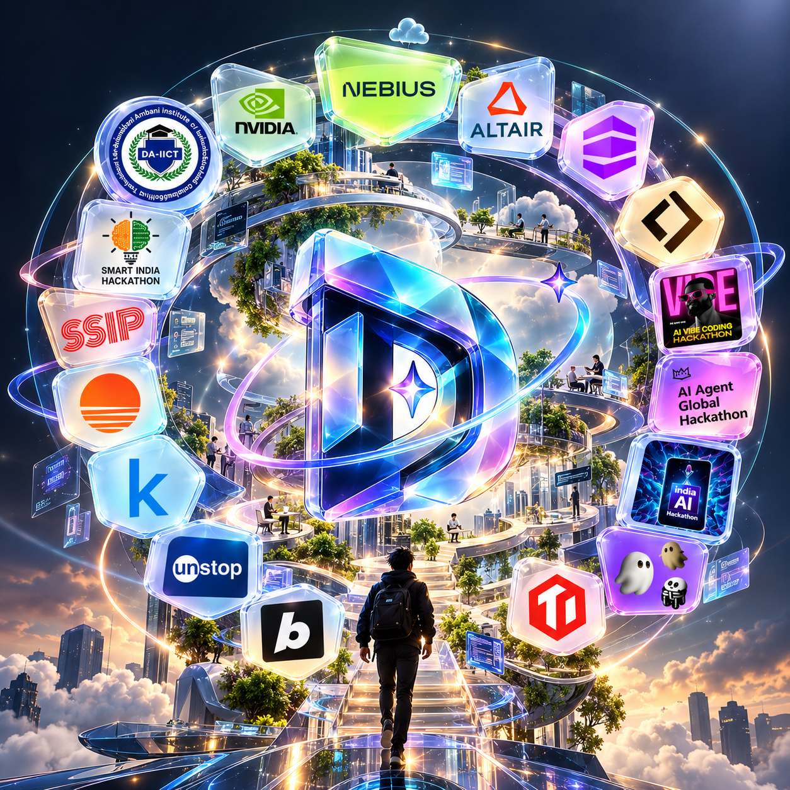
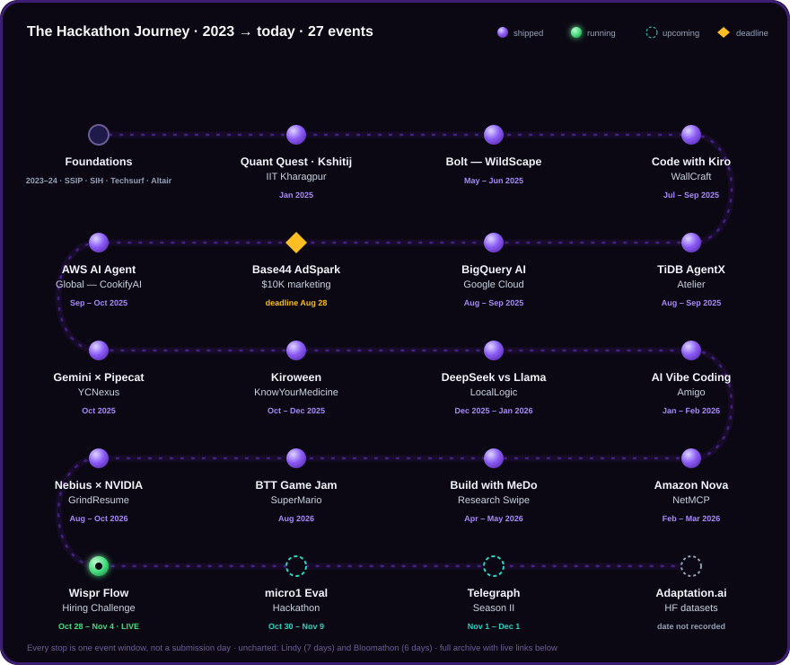

<div align="center">



# Maahin Panchal

**Full-Stack & AI/ML Engineer · Founding Engineer**

I take ideas end to end — sole-engineered a multi-tenant SaaS (86+ edge functions, Stripe, Row-Level Security),
shipped enterprise RAG and sub-200ms voice AI. **Idea → working product, with AI as part of the stack.**

Ahmedabad, India · remote-friendly

[Portfolio](https://maahin.lovable.app/) · [LinkedIn](https://linkedin.com/in/maahinvimlesh-panchal) · [GitHub](https://github.com/MaahinVPanchal) · [Devpost](https://devpost.com/maahinpanchal) · maahinpanchal@gmail.com · +91 92744 68476

</div>

---

## 🐎 Darkhorse Trading — the honest counter-example

> **[darkhorse-trading](https://github.com/MaahinVPanchal/darkhorse-trading)** 🐎 — an open-source AI trading desk
> that publishes **every trade and every loss**.
> The counter-example to those *"$14 → $7,643"* trading screenshots.

> ⚠️ **Safety notice** — I will NEVER ask you for:
> - private keys or seed phrases
> - deposits, payments, or "signal group" fees
> - remote access to your machine
>
> Anyone doing so under my name is a scammer — **report and block**.
>
> **Official repos:** only the ones listed on this profile. Forks must be renamed and are not affiliated.
>
> *Not financial advice. Perps can liquidate 100% of an account.*

---

## 🃏 The Card I'm Holding

```python
class Maahin(FullStack_AIMLEngineer):
    """Idea → working product, with AI as part of the stack."""

    Lastly     = "Full-Stack & Voice AI Engineering Intern @ Unloq"
    location   = "Ahmedabad, India · remote-friendly"
    education  = "B.E. Information Technology — L.D. College of Engineering, 2025"
    cgpa       = 8.43
    ownership  = "sole engineer → 86+ edge functions, billing, RLS, PII masking, audit logs"
    breadth    = ("full-stack", "RAG", "real-time voice AI", "computer vision")
    evidence   = ("₹2,49,000 SSIP grant", "3rd @ IIT Kharagpur 2025")
    hackathons = 27  # 24 shipped · 3 live right now
    side_quest = "Darkhorse Trading — the open-source AI trading desk"
    email      = "maahinpanchal@gmail.com"
```

---

## 💼 Experience

**Unloq® — Full-Stack & Voice AI Engineering Intern** · Remote · May 2026 — Present
AI-driven platform in the healthcare communication space.
- Built knowledge-management and retrieval pipelines across frontend and backend
- Implemented AI safety guardrails and output validation in production
- Strengthened multi-tenant data isolation, audit logging and security controls
- Merged parallel development streams into one well-tested, spec-driven codebase

**Aegis Whistle — Founding Engineer** · Remote · Nov 2025 — Apr 2026
Multi-tenant SaaS built 0→1 as the sole engineer.
- 86+ Supabase Edge Functions on PostgreSQL with Row-Level Security and SQL migrations
- React 18.3 + TypeScript + Vite · Framer Motion · Recharts
- ElevenLabs Voice AI, Google Gemini feedback analytics, Vectara semantic search via MCP
- Stripe subscriptions, Twilio voice/SMS/WebRTC, RBAC, device fingerprinting, PII masking
- Deployed on Netlify + Supabase Edge Functions

**Sufalam Technologies — AI/ML Engineer** · Ahmedabad · Jul 2024 — Oct 2025
- YOLOv8 + Roboflow object detection for keyboard internals — CPU sockets, RAM slots, PCIe
- APK-based screen-damage detection system with TensorFlow + Android
- Balance Sheet Analyzer — OpenAI natural-language Q&A with KPI charting
- Production chatbot on AWS (S3, Lambda, DynamoDB, Bedrock) with Django, Redis, Cloudflare
- Voice AI agents for communication using LiveKit

**CSEdge — Python Developer Intern** · Remote · Jun 2024 — Jul 2024
- BeautifulSoup web scrapers, NLTK chatbot mapped via JSON
- Flask task-management tool and PyAudio voice recorder with a friendly UI

---

## 🚀 Projects

| Project | Stack | What it does |
|---|---|---|
| **Bodhi** — Enterprise RAG | Bedrock · OpenSearch · Redis · Python | Turns PDFs into LLM-queryable knowledge bases with sub-second retrieval |
| **YCNexus** — Voice Interview Agent | FastAPI · Pipecat · Gemini Live · Tavus · WebRTC | Real-time mock interviews: STT → Gemini Live → TTS with an avatar YC partner |
| **Research Swipe** · [live](https://app-bd1pgg0jc6pt.appmedo.com/) | OpenAI · Gemini · Claude · Groq | Tinder-style discovery of the top 101 AI researchers; paper in, 10 deep-dive questions out |
| **GrindResume** · [live](https://grindresume.lovable.app/) | Nebius | Pick a company, see its real open roles, get an honest fit verdict from your resume evidence |
| **Balance Sheet Analyzer** | OpenAI · Python | Upload a balance sheet, ask questions, get KPI charts |
| **VideoMeet** | Flask · ZEGOCLOUD | Web conferencing with real-time speech-recognition pipelines |
| **Vocabulary Builder** | Python · Wiktionary | Multilingual flashcards from a custom Wiktionary parser |
| **Keyboard Parts Detection** | YOLOv8 · Roboflow | Detects CPU sockets, RAM slots and PCIe, validated with confusion matrices |
| **Coc Stat** | Contentstack · Flask | Headless CMS architecture — 5 content models, 11 entries, Flask APIs |
| **Workflow Automation** | n8n · OpenAI | Chat-embedded agents with memory buffers and calculator nodes |
| **Google Clone** | ReactJS | Search dynamics via Google Search, YouTube Data and News APIs |

Full walkthroughs on the [portfolio](https://maahin.lovable.app/).

---

## 🎪 Hackathon Journey — 24 shipped · 3 live right now

<div align="center">



</div>

### 🔴 Running now & next

| Challenge | Window | The brief |
|---|---|---|
| **Wispr Flow Hiring Challenge** 🔴 | `Oct 28 – Nov 4` | Interactive portfolio built with Wispr Flow voice input + a vibe-coding tool, demo video ≤ 3 min |
| **micro1 Eval Hackathon** | `Oct 30 – Nov 9` | On HackerRank: a rigorous, reproducible evaluation showing where frontier AI still fails — solo, online *(dates = the invite's login window)* |
| **Telegraph Hackathon Season II** | `Nov 1 – Dec 1` | $10,000 prize pool · Miners, Evaluators, and Apps & Agents tracks across 15 commercial missions |

<details>
<summary><b>📜 Year-by-year — all 24 shipped</b></summary>

**2026**

- **Nebius × NVIDIA Global AI Hackathon** · `Aug 26 – Oct 30` — GrindResume: pick a company, see its real open roles, get an honest fit verdict from your resume evidence · [live](https://grindresume.lovable.app/)
- **BTT Web Game Jam, Summer 2026** · `Aug 7 – 21` — SuperMario: a solo-built 8-world platformer *(Devpost page later removed; dates from third-party listings)* · [play](https://supermarioold.lovable.app/)
- **Build with MeDo Hackathon** · `Apr 9 – May 20` — Research Swipe: discover top AI researchers and master their papers · [live](https://app-bd1pgg0jc6pt.appmedo.com/)
- **Bloomathon (Bloom)** · *6 days, 2026* — a separate Bloom app challenge, distinct from AI Vibe Coding; results posted April 2026 · [live](https://app.diy/uneven-spoonbill-jffavz)
- **Amazon Nova AI Hackathon** · `Feb 2 – Mar 16` — NetMCP: real-time network intelligence for AI assistants
- **AI Vibe Coding Hackathon** · `Jan 30 – Feb 2` — Amigo: the audio-first AI interview coach · a 72-hour sprint

**2025**

- **DeepSeek vs. Llama: Kill The Cloud** · `Dec 13 – Jan 30` — LocalLogic: privacy-first, offline-native AI · spans the new year
- **Kiroween** · `Oct 31 – Dec 5` — KnowYourMedicine: AI medical verification and wellness app
- **Lindy CMO Challenge** · `Oct · 7 days` — Comic Learning Assistant, named a standout build by Lindy · winners posted Oct 31
- **AI Tinkerers: Gemini × Pipecat** · `Oct 11 – 19` — YCNexus: a real-time voice-to-voice AI interviewer
- **AWS AI Agent Global Hackathon** · `Sep 8 – Oct 22` — CookifyAI: an AI sous-chef on AWS Bedrock and Nova
- **Base44: Build the Dream ($10K Marketing Challenge)** · `deadline Aug 28` — AdSpark, a marketing-tech build · single deadline, not an event span
- **BigQuery AI: Building the Future of Data** · `Aug 12 – Sep 23` — Google's data and AI challenge
- **TiDB AgentX Hackathon 2025** · `Aug 1 – Sep 15` — Atelier: bridging Patola heritage with AI fashion assistants
- **Code with Kiro Hackathon** · `Jul 14 – Sep 15` — WallCraft: making desktop customization magical
- **World's Largest Hackathon (Bolt)** · `May 30 – Jun 30` — WildScape: gamifying wildlife conservation · [live](https://peaceful-tulumba-ad339b.netlify.app/)
- **Quant Quest, Kshitij 2025 (IIT Kharagpur)** · `Jan 17 – 19` — backtested algorithmic trading strategies, with AlgoBulls

**2024**

- **Altair Data Science Contest (IIT Kharagpur)** · `Nov 2024` — 3rd prize in the Altair RapidMiner data analytics challenge · registration closed Nov 2, final submission Nov 10
- **Techsurf 2024 (Contentstack)** · `Sep 18 – Oct 23` — headless CMS and Python–Next.js architecture, deep end first
- **Quiz Competition (Unstop)** · `2024` — no exact date recorded

**2023**

- **HackOut '23** · `2023` — my first collaborative website
- **SSIP Hackathon (Gujarat)** · `2023` — won a ₹2,49,000 grant for a YOLOv8-powered vision project
- **Smart India Hackathon** · `2023` — built a travel portal

**Undated**

- **Adaptation.ai** — Hugging Face patient-financial-recovery datasets · [base](https://huggingface.co/datasets/maahin/adaption-patient-financial-recovery) · [augmented](https://huggingface.co/datasets/maahin/adaption-patient-financial-recovery-augmented) · *no event date recorded*

<sub>**Caveats:** the Bolt page also shows a separate *"Deadline: July 31"* line, so May 30 – Jun 30 is the event window, not a confirmed final-submission deadline · the Bloomathon and AI Vibe Coding are two separate events — AI Vibe's dates come from the organizer's own Devpost announcement (page since removed) · the three current challenges are counted separately from the 24 above · dates are the events' windows, not personal submission days, checked 31 Oct 2026 against live pages where they still exist.</sub>

</details>

---

## 🧠 Skills

**Languages**

&nbsp;


**Frontend & Backend**

&nbsp;


**AI / ML**

&nbsp;


**Cloud, Data & Tools**

&nbsp;


**AI Toolkit — daily drivers**


---

## 🎓 Education

**B.E. Information Technology — L.D. College of Engineering, Ahmedabad**
Sep 2021 – Jul 2025 · CGPA 8.43 · CPI 8.37 · SPI 9.00

---

## 📮 Contact — let's put a smile on that product

- **Email** — maahinpanchal@gmail.com
- **Phone** — +91 92744 68476
- **Portfolio** — [maahin.lovable.app](https://maahin.lovable.app/)
- **LinkedIn** — [maahinvimlesh-panchal](https://linkedin.com/in/maahinvimlesh-panchal)
- **GitHub** — [MaahinVPanchal](https://github.com/MaahinVPanchal)

<div align="center">

---

<sub>ha&nbsp;ha&nbsp;ha&nbsp;·&nbsp;© 2026 Maahin Vimlesh Panchal&nbsp;·&nbsp;Ahmedabad, India 380061</sub>

</div>
